# l2s pushT argmax v final candidate

W&B report: https://wandb.ai/l2sml/pushT_diffusion_search/reports/l2s-pushT-argmax-v-final-candidate--VmlldzoxODE2MTY2OA==

**Draft.** PushT, 50 demos, bottom-left quadrant held out (blq50far), 50 held-out test episodes per seed, seeds 42–44. Runs: each arm's **best checkpoint anywhere in its sweep** (test-selected: 2k for every ST arm, 10k for BC), clean observations, plus corrupted observations for the two noise arms whose best cell is a corrupted-obs cell (flat600, ramp seed 44). Numbers below are seed means.

**How the N candidates are made.** PushT search is chunked and closed loop: at every decision the policy generates a stream of 64 candidate 16-step action chunks (candidate k sees the previous ones and their verifier values; K ≤ 16 slot context, rolling window past K), scores each with the waypoint verifier (`wp_v3_la_tgn`: ≤ 0, higher is better; a candidate whose simulated chunk reaches task success scores exactly **2.0**), executes one chunk (8 env steps) and moves on. The maze report's stream is one set of 64 full trajectories per episode; here N = 1…64 are prefixes of the **per-decision** stream of the N = 64 argmax rollout: **argmax** = best score among the first N, **final** = candidate N, **first** = candidate 1. Episode success is closed loop and comes from the existing sweeps (argmax vs final-pass selection, N = 1…64, same checkpoints). Under **final_pass** the policy searches N − 1 candidates and executes an unscored N-th sample conditioned on them; for this analysis that sample was additionally simulated once per decision (logging only), so it can be placed inside the context it came from.

**Caveat.** The stream rollouts replay the sweeps' protocol (same seeds, `paired_decision_v3`, terminal scoring) and reproduce their success rates to within a few episodes, but are not bit-identical to the sweeps' per-episode rewards (GPU type and code have moved since those evals ran; run-to-run on one GPU type is bit-identical). Per-decision numbers therefore describe the stream rollout, closed-loop numbers the sweeps.

## Q1 · Does the argmax candidate's score improve from N = 1 to N = 64?

**Yes, by 15–39 score units per decision, almost entirely by picking a higher-scoring miss.** At N = 1 the argmax is candidate 1 (mean score −129 to −107); at N = 64 it is −114 to −75. Per decision, comparing the argmax at N = 64 with candidate 1: 0.88–0.93 of decisions go from a miss to a higher-scoring miss, only 0.02–0.04 from a miss to a **success candidate** (score 2.0), and 0.04–0.08 are unchanged. A success candidate exists among the first 64 in just 0.02–0.05 of decisions (0.00 at N = 1): the maze's "argmax = any of the first N succeeds" does not carry over, because a chunk rarely finishes the task by itself. What argmax buys per decision is a chunk that advances the waypoint plan further, and closed loop those gains compound over the episode's 20–38 decisions (bottom row of the figure). Verifier-blind decisions (every candidate scores the same) are 0.00–0.01 of decisions.

| Group (seeds) | Argmax score N = 1 / 8 / 64 | Argmax picks a success cand. N = 1 / 8 / 64 | Miss → higher miss | Miss → success cand. | Unchanged | Blind decisions |
|---|---|---|---|---|---|---|
| BC · clean (42, 43, 44) | -129 / -118 / -114 | 0.00 / 0.01 / 0.02 | 0.91 | 0.02 | 0.07 | 0.01 |
| ST k1 · clean (42, 43, 44) | -120 / -90 / -81 | 0.00 / 0.01 / 0.04 | 0.92 | 0.04 | 0.04 | 0.00 |
| ST k16 uniform · clean (42, 43, 44) | -117 / -94 / -85 | 0.00 / 0.01 / 0.03 | 0.93 | 0.03 | 0.05 | 0.00 |
| ST k16 flat600 · clean (42, 43, 44) | -107 / -89 / -80 | 0.00 / 0.01 / 0.04 | 0.88 | 0.04 | 0.08 | 0.00 |
| ST k16 flat600 · corrupt obs (42, 43, 44) | -108 / -84 / -75 | 0.00 / 0.01 / 0.05 | 0.89 | 0.04 | 0.06 | 0.00 |
| ST k16 ramp200to600 · clean (42, 43, 44) | -108 / -88 / -80 | 0.00 / 0.01 / 0.03 | 0.91 | 0.03 | 0.05 | 0.01 |
| ST k16 ramp200to600 · corrupt obs (44) | -113 / -92 / -83 | 0.00 / 0.01 / 0.03 | 0.92 | 0.03 | 0.05 | 0.00 |

## Q2 · Keep only candidate 1 but still generate N: does anything go up?

**No, by construction.** Candidate 1 is drawn before any context exists and the stream is causal, so the candidates after it cannot change it; the eval also restarts candidate 1's noise per decision, so it is the same draw at every N (flat dotted line). Generating more only pays off if a later candidate is kept:

- **Argmax** (solid) climbs with N per decision, and closed-loop argmax success at N = 64 is 0.53–0.80 across groups.
- **Final**, candidate #N (dashed), is flat or slightly *below* candidate 1 per decision (−129 to −110 vs −129 to −107 at N = 64), and closed-loop final-pass success is 0.00 at every N for every ST arm.

| Group (seeds) | Keep #1: score (every N) | Keep final #64: score | Keep argmax of 64: score | Closed loop N = 1 / 16 / 64: argmax | Closed loop N = 1 / 16 / 64: final_pass |
|---|---|---|---|---|---|
| BC · clean (42, 43, 44) | -129 | -129 | -114 | 0.02 / 0.34 / 0.53 | — / — / — |
| ST k1 · clean (42, 43, 44) | -120 | -120 | -81 | 0.00 / 0.24 / 0.77 | 0.00 / 0.00 / 0.00 |
| ST k16 uniform · clean (42, 43, 44) | -117 | -120 | -85 | 0.00 / 0.22 / 0.63 | 0.00 / 0.00 / 0.00 |
| ST k16 flat600 · clean (42, 43, 44) | -107 | -113 | -80 | 0.00 / 0.46 / 0.73 | 0.00 / 0.00 / 0.00 |
| ST k16 flat600 · corrupt obs (42, 43, 44) | -108 | -113 | -75 | 0.00 / 0.29 / 0.80 | 0.00 / 0.00 / 0.00 |
| ST k16 ramp200to600 · clean (42, 43, 44) | -108 | -110 | -80 | 0.00 / 0.35 / 0.63 | 0.00 / 0.00 / 0.00 |
| ST k16 ramp200to600 · corrupt obs (44) | -113 | -118 | -83 | 0.00 / 0.30 / 0.74 | 0.00 / 0.00 / 0.00 |

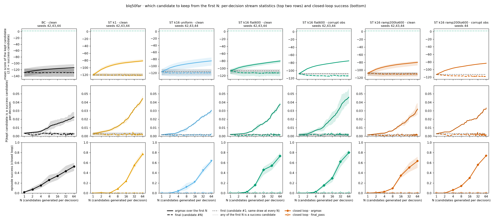

## Why final stays flat while argmax scales

1. **Later candidates are not better; candidate 1 is marginally the best.** Centered per decision, candidate 1 scores 0.3–5.3 above the decision mean and every later position sits at about 0 (second panel). Final at N is one draw from that flat tail, so it stays flat; argmax takes the max of N exchangeable draws, so it grows like best-of-N.
2. **The stream does not steer.** Records above the permutation null (sum over k ≥ 2 of P(candidate k is a new running max) − the same decision's values shuffled) are −0.28 to 0.04: zero or negative, i.e. conditioning on earlier candidates and their scores produces no more improvements than reordering them would (the negative values come from candidate 1 being the best more often than a shuffle predicts). The success-candidate lag-1 test is uninformative here because success candidates are so rare.
3. **The executed final-pass sample is a typical draw, not an improvement.** It out-scores the argmax of its 63 context candidates in 0.01 of decisions, has mean rank 28–32 of 64 (uniform would be 32), and sits −39 to −27 score units below the context's best (right panel). Its mean score (−301 to −232) is also far below the argmax rollout's candidates (−129 to −110): without selection the policy drifts into worse states and stays there.

| Group (seeds) | Centered score #1 / #2–8 / #9–64 | Final score N = 2 / 8 / 64 | Argmax score N = 2 / 8 / 64 | Excess records | final_pass: beats argmax of context | final_pass: mean rank of 64 | final_pass: score − context best |
|---|---|---|---|---|---|---|---|
| BC · clean (42, 43, 44) | +0.3 / -0.1 / +0.0 | -129 / -129 / -129 | -124 / -118 / -114 | 0.01 | — | — | — |
| ST k1 · clean (42, 43, 44) | +0.3 / +0.2 / -0.0 | -120 / -121 / -120 | -105 / -90 / -81 | 0.04 | 0.02 | 28 | -27 |
| ST k16 uniform · clean (42, 43, 44) | +3.0 / -0.3 / -0.0 | -120 / -120 / -120 | -105 / -94 / -85 | -0.27 | 0.02 | 30 | -35 |
| ST k16 flat600 · clean (42, 43, 44) | +5.3 / +0.3 / -0.1 | -111 / -112 / -113 | -98 / -89 / -80 | -0.27 | 0.01 | 31 | -39 |
| ST k16 flat600 · corrupt obs (42, 43, 44) | +5.2 / +0.2 / -0.1 | -112 / -113 / -113 | -95 / -84 / -75 | -0.22 | 0.02 | 28 | -36 |
| ST k16 ramp200to600 · clean (42, 43, 44) | +1.9 / +0.1 / -0.0 | -110 / -110 / -110 | -98 / -88 / -80 | -0.28 | 0.01 | 32 | -35 |
| ST k16 ramp200to600 · corrupt obs (44) | +4.5 / +1.1 / -0.2 | -115 / -117 / -118 | -103 / -92 / -83 | -0.17 | 0.02 | 30 | -35 |

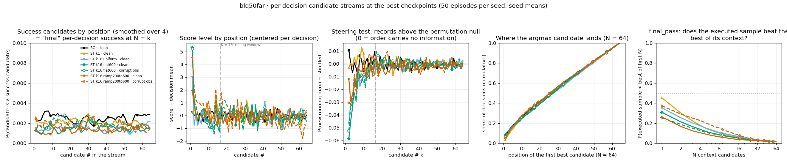

## Where the max candidate usually falls

Bars: share of decisions whose argmax (first best) is candidate #k, seeds pooled, verifier-blind decisions excluded. Black line: share of decisions in which candidate #k is tied for the best score. Dotted: 1/N.

- **Position carries no information past candidate 1.** The argmax lands uniformly over the stream: median position #26–28 of 64 (uniform would be 32), and the tied-for-best line is flat. Unlike the maze, where the argmax sits at #4–10 of 64 because goal-reaching candidates tie at the top and argmax takes the first, here it sits at the centre.
- **Candidate 1 is over-represented at small N** (argmax = #1 in 0.15–0.26 of decisions at N = 8 vs 0.125 uniform), the per-decision face of its slightly higher score; at N = 64 it is 0.04–0.08 (uniform 0.016).
- **Ties are few:** 2.2–4.1 candidates share the top score at N = 64, against 14–17 in the maze.

| Group (seeds) | Median argmax # N = 2 / 4 / 8 / 64 | Tied at max N = 8 / 64 | Argmax = #1 at N = 8 / 64 |
|---|---|---|---|
| BC · clean (42, 43, 44) | 1 / 2 / 4 / 27 | 1.5 / 4.1 | 0.19 / 0.06 |
| ST k1 · clean (42, 43, 44) | 1 / 2 / 4 / 27 | 1.2 / 2.3 | 0.15 / 0.04 |
| ST k16 uniform · clean (42, 43, 44) | 1 / 2 / 4 / 28 | 1.2 / 2.2 | 0.18 / 0.05 |
| ST k16 flat600 · clean (42, 43, 44) | 1 / 2 / 4 / 28 | 1.5 / 3.3 | 0.26 / 0.08 |
| ST k16 flat600 · corrupt obs (42, 43, 44) | 1 / 2 / 4 / 27 | 1.3 / 3.0 | 0.23 / 0.06 |
| ST k16 ramp200to600 · clean (42, 43, 44) | 1 / 2 / 4 / 26 | 1.2 / 2.3 | 0.18 / 0.05 |
| ST k16 ramp200to600 · corrupt obs (44) | 1 / 2 / 4 / 26 | 1.2 / 2.7 | 0.19 / 0.05 |

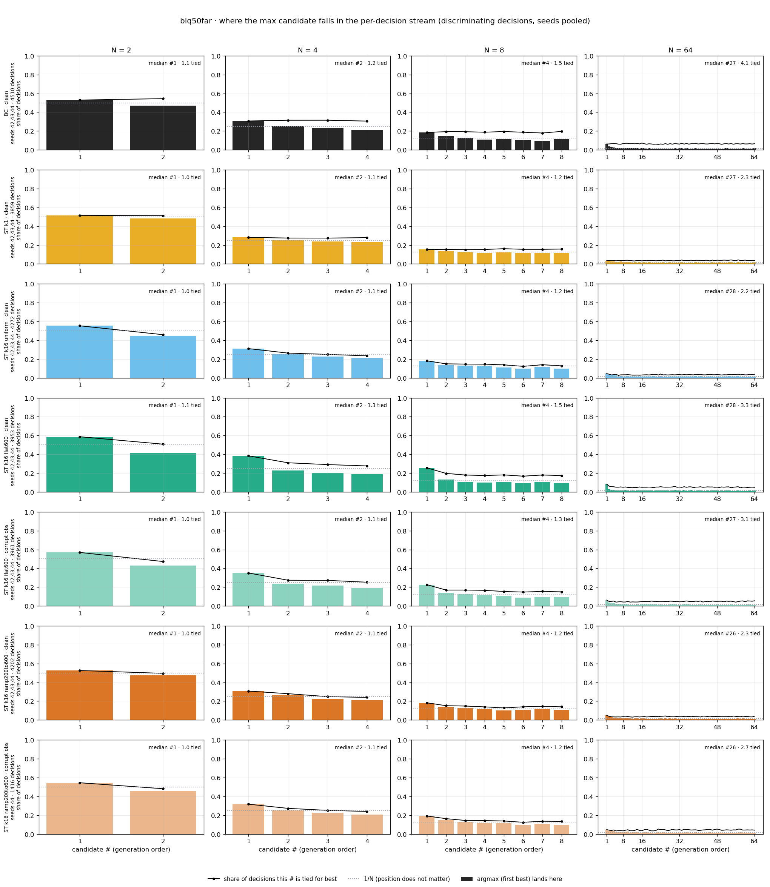

## Five episodes, every candidate

Episodes 0–4 of the held-out test set (unselected; the same episodes for every run), seed 42, decisions 0 / 5 / 10 / 20. Each panel: score of each candidate in generation order. Circle = argmax over the first 64 (first best), square = candidate #64, green star = success candidate (2.0); in the final-pass panels the red diamond at #64 is the executed sample's own score. Scores rise toward 0 as the episode advances the waypoint plan; success candidates appear only in the last decisions. Other seeds' panels are logged to this report's asset run under `argmax/episodes/`.

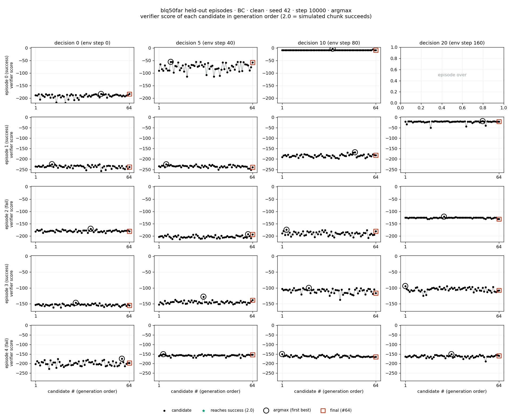

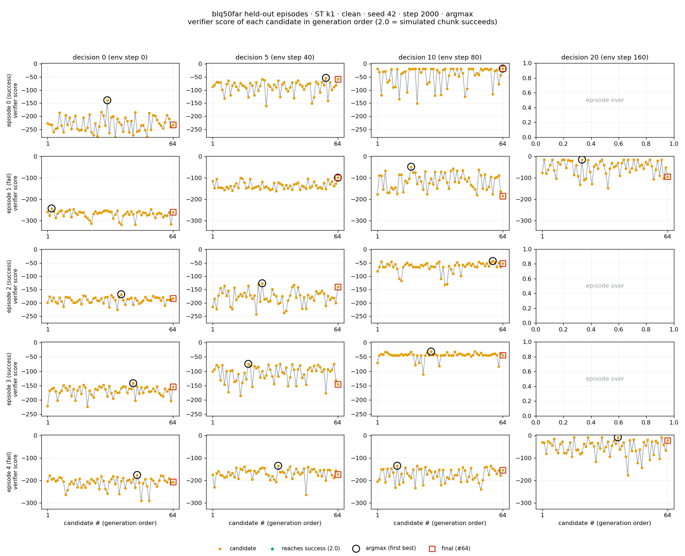

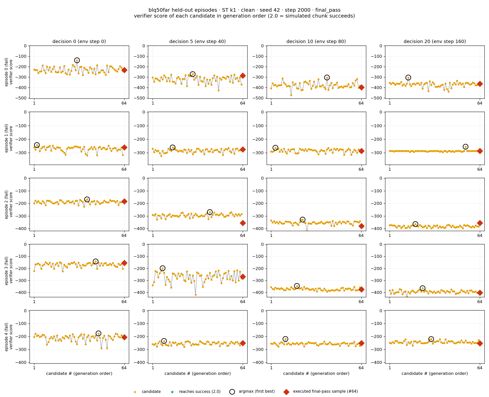

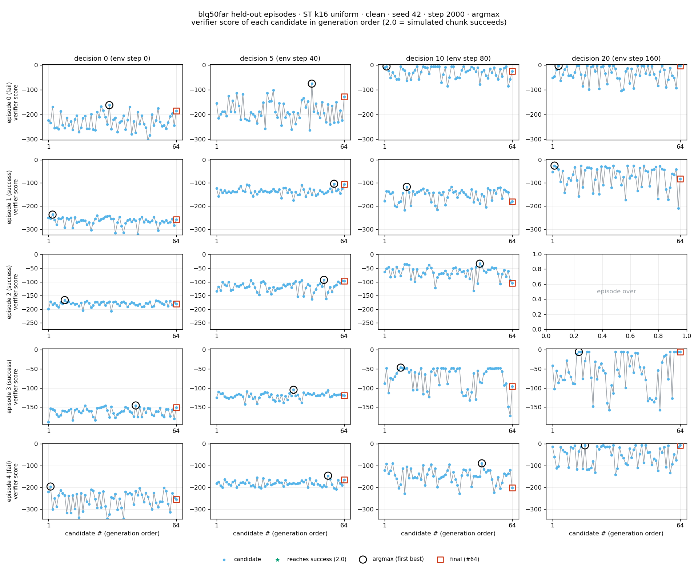

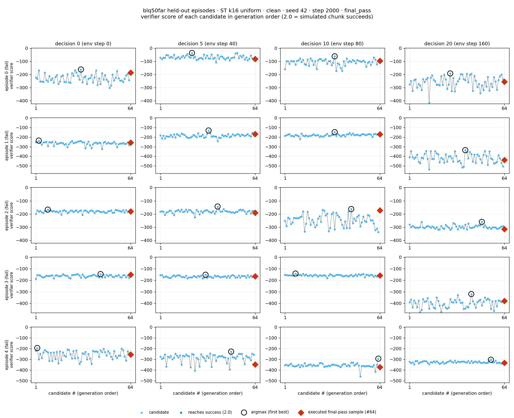

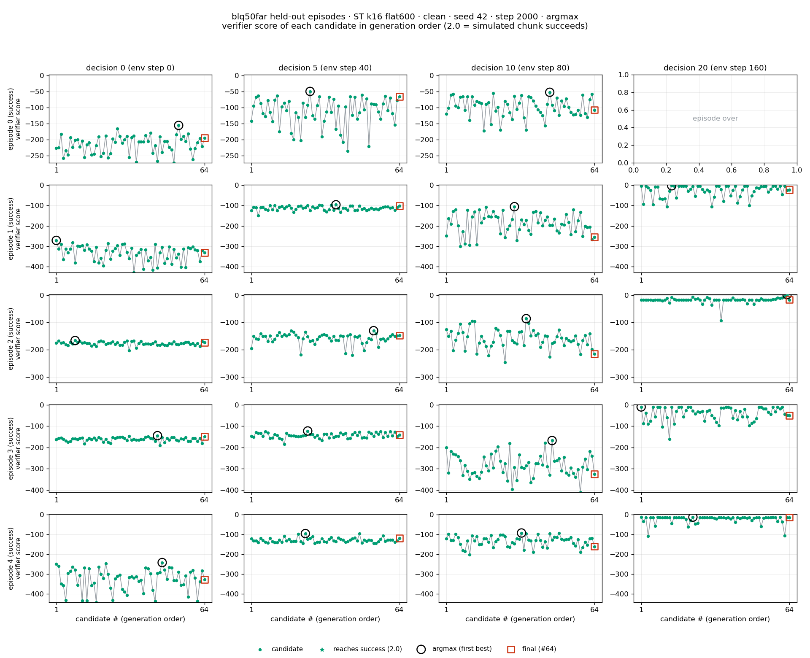

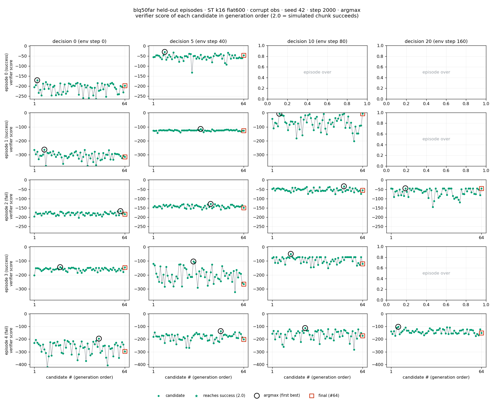

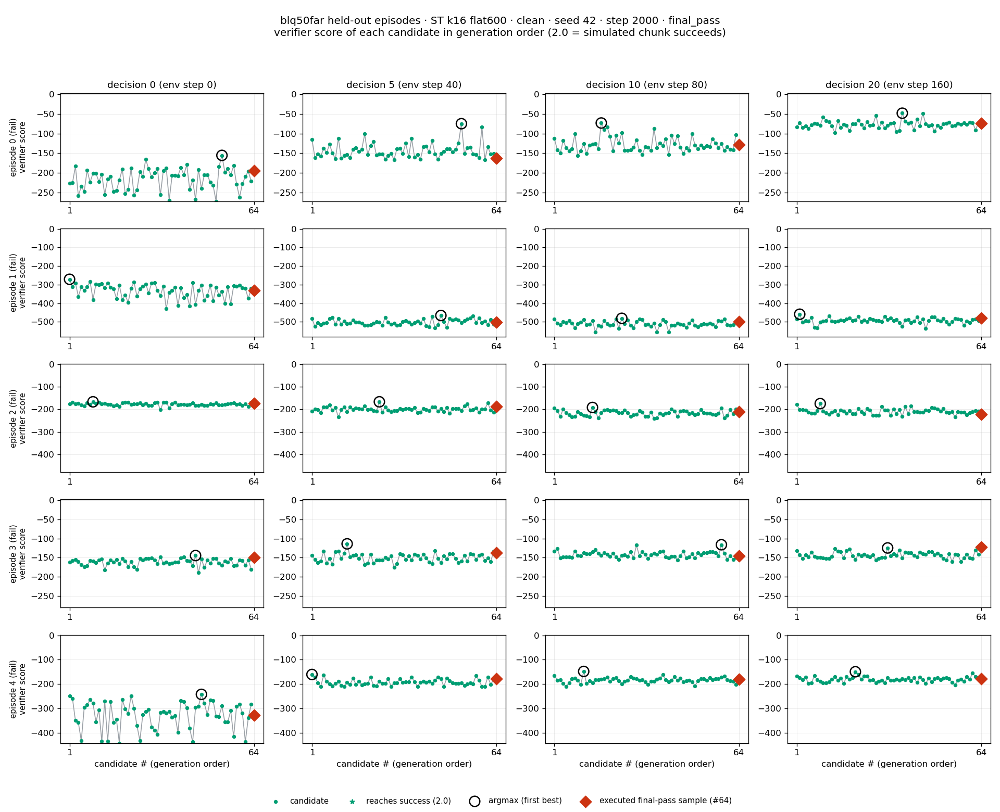

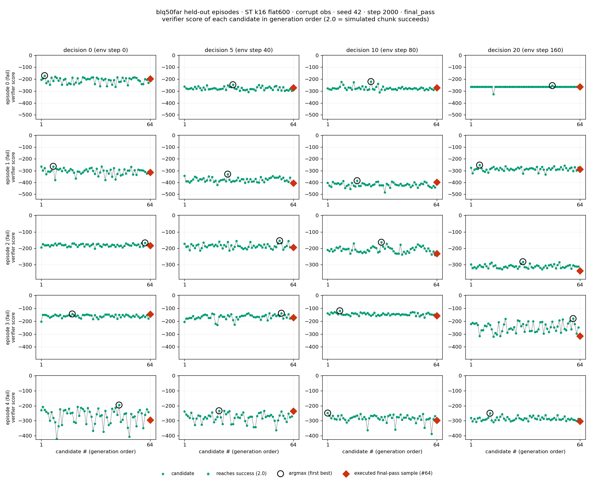

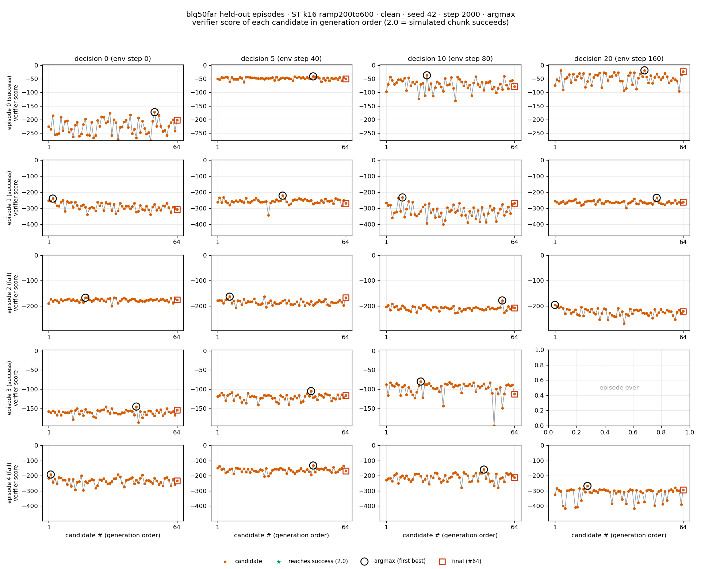

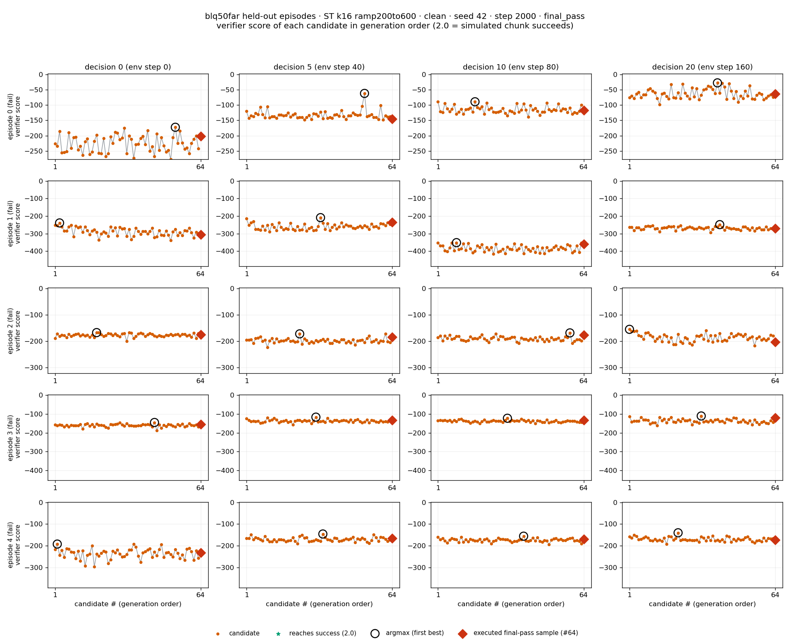

Source: `codex_audits/pusht_argmax_position_20261022/analysis.py` (reads `candidate_streams_*/step_*/candidate_scores.jsonl` written by `eval_search_pusht.py --store-scores` and the runs' `bon_search_*/step_*/success_curve.json`); per-run and per-group numbers in `summary.json`.
